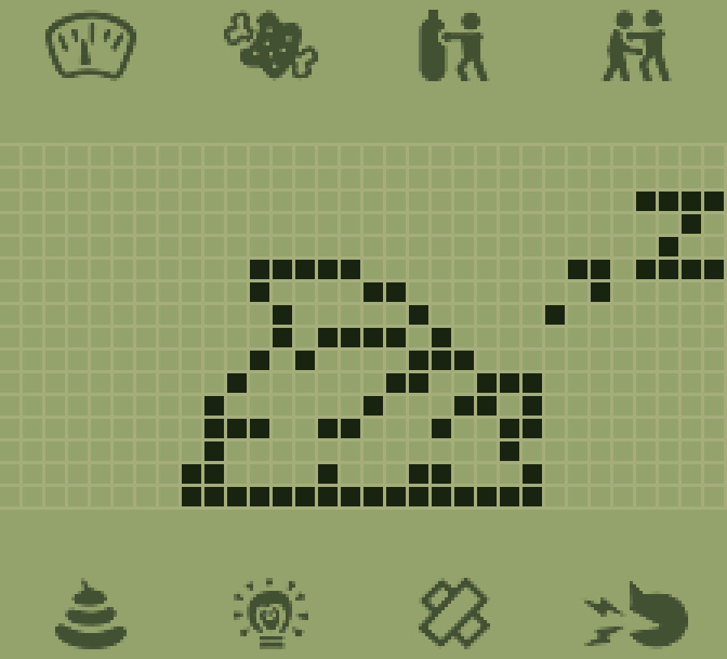
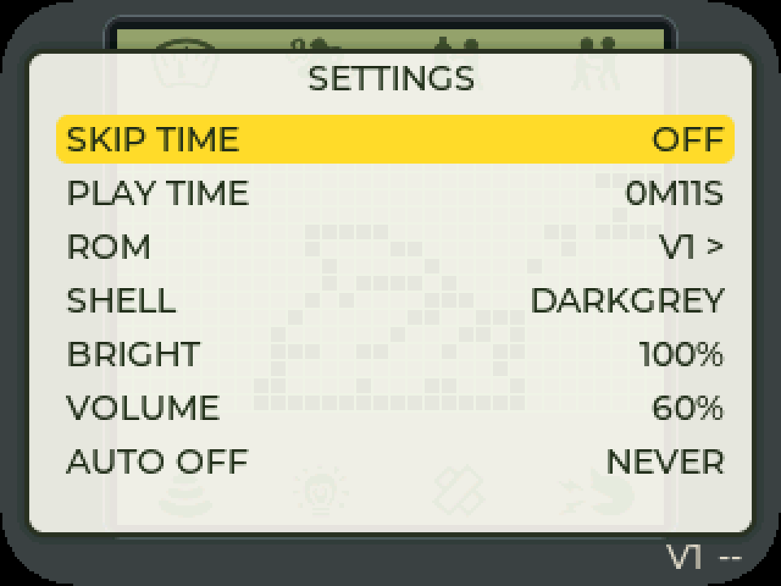
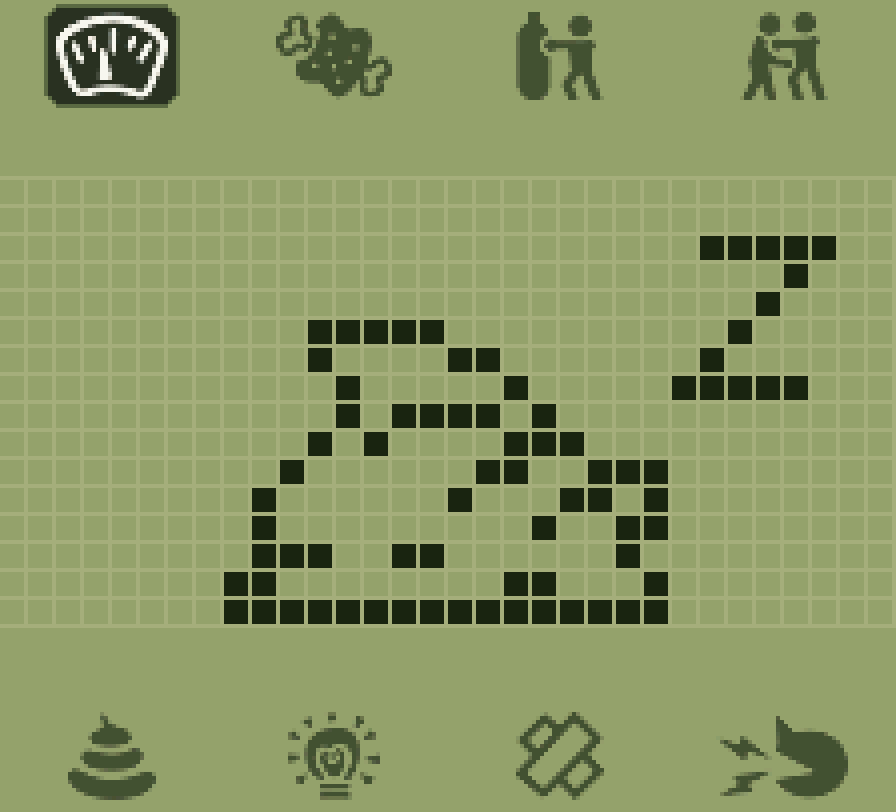

# Digital Monster on AI Passport

<p align="center">
  
  
  
</p>
<p align="center"><sub>画面来自真机存档，在固件仿真里还原：玻璃三色、7 个功能图标、32×16 点阵都是固件真实输出</sub></p>

把 Bandai《Digital Monster》（数码暴龙机，1997）的**原版 V1 / V2 / V3 / V4 固件**跑在
**FoloToy AI Passport**（ESP32-C3，240×320 屏，三个按键）上。

不是复刻玩法，是把原机的 4-bit MCU 完整模拟出来：CPU、定时器、中断、按键扫描、
1-bit 蜂鸣器全部按原机行为实现，并用 **50 万步逐位比对**锁定行为
（`pc trace sha256: f42d1802…`）。屏幕版式按真机玻璃实测还原：一块玻璃三条带 ——
上下各 4 枚功能图标（独立 LCD 段，由 ROM 自己点亮）、中间 32×16 点阵。

**v2.1.2** · MIT · 不含任何 Bandai 的固件或美术资源（ROM 需自备，见 `roms/README.md`）

## 特性

- **ROM 与固件分离**：ROM 走独立 `roms` 数据分区（8 槽 × 32 KB），网页端一键上传 / 切换 / 擦除，刷固件不动存档。
  支持 V1 / V2 / V3 / **V4**（同一套 E0C6200 核心，规则表按 ROM 名与 CRC 自动切换）
- **存档**：每槽一份 NVS 存档（magic + ROM CRC + 状态 CRC），**60 秒**滚动保存，可导出成 `.hex` 备份
- **双主题**：机身与玻璃两套观感，菜单里切
  - `A CLASSIC`：实色塑料壳 + 橄榄绿点阵（初版样式）
  - `C RETAIL`：手绘石墙砖纹机身 + 全分辨率海景背景 + 黑色点阵与图标
  - 外壳色 8 种（BROWN / GREY / RED / GREEN / BLUE / YELLOW / WHITE / DARKGREY），存 NVS
- **设置菜单收成 5 行**：`TIME` / `ROM` / `BATTLE` / `APPEAR` / `POWER`，后三组各带二级面板
- **时钟页长按 A = 原机 A+C**：进入调时间（原机要同时按 A、C，而本机三键共用一个 ADC 脚，
  物理上按不出组合键 —— 固件在时钟页把长按合成成 A+C 注入 ROM）
- **离线卡片对战**：不接电脑、不接第二台机器也能打 —— 8 张卡片存在 NVS 里，
  固件替对手回 D-Link 的两帧，自己按键走进对战界面
- **PC 控制台**：单文件 `tools/digimon_studio.html`，Web Serial 直连，四页 ——
  ROM/存档、养成、调试、对战
- **配图进化树**：按 ROM `0x0D10` 跑遍 **14,112** 组养育条件得到的实测规则，画成说明书那种
  分栏卡片树，命中当前数据的分支高亮
  > 公开仓库版的 `tools/digimon_studio.html` 是**无图精简版**：卡片配图与整幅官方路线图
  > 裁自说明书扫描件，版权原因不随仓库分发。带图完整版只随本地交付包提供。
- **真跑式跳过时间**：`SKIP TIME` 真执行游戏时间（C3 上约 0.98 s / 游戏分钟），不是改数值；
  档位 OFF / 5M / 30M / 1H / 2H / 12H / 24H，执行时玻璃上有进度卡，C 可中止

## 快速开始

### 1. 构建

需要 ESP-IDF 5.5.x：

```bash
cd firmware/digimon-passport
idf.py set-target esp32c3
idf.py build
```

### 2. 刷机

```bash
# 只刷 app（存档 / 设置 / ROM 都保留）
python -m esptool --chip esp32c3 -p COM5 -b 921600 write_flash \
    --flash_mode dio --flash_freq 80m --flash_size 8MB \
    0x10000 build/FoloToy-AI-Passport.bin
```

从更老的、分区表不同的版本升上来时，先补一次 `0x8000 partition-table.bin`（4 KB，不动 NVS）。

**全新板子 / 救砖**要整片镜像（擦 `0x0`）。`idf.py build` 不会自动合并，自己生成一份：

```bash
python tools/mk_full_bin.py --out FoloToy-AI-Passport-full.bin
# 想把 ROM 一起铺进去（自备镜像）：
python tools/mk_full_bin.py --out full-with-roms.bin \
    --rom 0=roms/digimon.bin:V1 --rom 1=roms/digimonv2.bin:V2
```

然后 `write_flash 0x0 FoloToy-AI-Passport-full.bin`。**这会清 NVS**（存档 / 设置 / PLAY TIME 全没）——
已经养着宠物的机器不要走这条路，日常升级只刷 `0x10000`。

### 3. 装 ROM

刷完屏上显示 `NO ROM` 是正常的。把自备的镜像改名成 `roms/digimon.bin`（V1）等，
用 PC 工具传到任意槽位（0–7）。详见 `roms/README.md`。

### 4. PC 控制台

用 Edge / Chrome 直接打开 `tools/digimon_studio.html`（`file://` 即可），点「连接设备」选串口。
无需安装、无需起服务器。说明书见 `docs/studio-tool.md`。

## 按键

三个键 1:1 对应原机 A / B / C。原机没有长按语义，长按只会被按键扫描当成反复按下；
固件把每次按下垫到 260 ms，避开原机约 120 ms 的按键扫描门槛。

| 按键 | 原机键 | 作用 |
|---|---|---|
| 上 / UP | A | 循环 7 个功能图标（状态 → 食物 → 训练 → 对战 → 便便 → 灯 → 药） |
| 中 / DOWN | B | 进入当前图标的功能页 |
| 下 / OK | C | 取消 / 返回 |

**长按 OK 3 秒**打开设置菜单（原机没有）。菜单里 `A` 走行、`B` 改值或进二级、`C` 关：

| 一级 | 二级 |
|---|---|
| `TIME` | `SKIP TIME`（OFF/5M/30M/1H/2H/12H/24H）、`PLAY TIME`（可清零） |
| `ROM` | 8 个槽位表，`B` 启动 |
| `BATTLE` | 8 张离线对战的卡片 |
| `APPEAR` | `STYLE`（A / C）、`SHELL`（8 色） |
| `POWER` | `BRIGHT`（20–100 %）、`VOLUME`、`AUTO OFF` |

**时钟界面长按 A 1.2 秒**会合成原机的 A+C，进入调时间（ROM 的 `sub` 一变就松手；
调时间页里长按 A 归 ROM 自己的快速递增，固件不再插手）。
电源键是硬件闩锁、没接 MCU，固件读不到，不能用来做任何功能。

## 目录

```
firmware/digimon-passport/   固件工程（ESP-IDF 5.5 / esp32c3）
  main/digimon_app.c         渲染（点阵 + 8 个功能段）、按键、音频、菜单、主循环
  main/core/digimon_core.c   E0C6200 CPU 核心（C99 移植，无 malloc）
  main/core/digimon_segmap.h 32×16 段映射表（由参考 SVG 逆向生成）
  main/dg_brick.h            样式 C 的石墙砖纹 tile（128×128，由脚本生成）
  main/dg_backdrop.h         样式 C 的海景背景（192×183 RGB565，由脚本生成）
  main/dg_cards.*            离线对战卡片的 NVS 存储与应答器
  main/dg_link.*             D-Link 波形层（有线中继与卡片模式共用）
  components/bsp/            屏幕 / 按键 / 音频 / 电池（来自 FoloToy 上游）
tools/                       PC 工具与生成器
  digimon_studio.html        单文件控制台（Web Serial，公开版无配图）
  gen_evo_rules.py           14112 组判定 → 12 条区间规则（含逐行回放校验）
  gen_brick_tile.py          样式 C 石墙 tile 生成器
  gen_backdrop.py            样式 C 背景生成器
  strip_studio_images.py     把带图版控制台压成公开版（去扫描件配图）
  dg_sim.mjs                 固件仿真截图/回归（boot/menu/groups/clock/ac20/rom/retail）
src/                         主机侧开发与回归工具
  test_core.c                黄金轨迹回归（50 万步逐位比对）
  card_test.c                离线卡片应答的主机测试
  probe_causal.c             RAM→屏幕因果扫描（找出某个数字来自哪个 nibble）
docs/                        交接单、复盘、控制台说明书、屏幕版式、省电实测
roms/                        ROM 放这里（不进仓库）
```

## 一些实测结论

- **进化判定是「四个 nibble 精确相等」**：`0x0596` 把阶段计时器 `M(48-4B)` 与目标时间
  `M(4C-4F)` 逐个 nibble 比较，全等才触发。跨过那一分钟就永久错过，ROM 会把目标写成 `0xFF`。
  另外 **小时是 8-bit 二进制，只有分钟是 BCD** —— 把它当 BCD 会让「早该进化却不进化」的假象骗你一整轮。
- **体重在 `M(56)`/`M(57)`，不是 `M(68)`**：`M(68-69)` 是种族基准体重（进化时写一次），
  屏幕上那个会涨的数在 `M(56)`（个位）/`M(57)`（十位），两位 BCD，上限 99 g。
  验证方法是把每个 nibble 逐个 +1 重画同一页，看哪一位能改变画面。
- **跳过时间只能真跑**：改 RAM 里的 stage 不会触发进化（ROM 只在自己的 tick 计数器跨过目标时判定），
  所以 2 小时档要跑约 150 秒 —— 这是硬件算力的硬成本。
- **战绩计数器是 4-bit 饱和**：`M(0x99)`（对战场数）与 `M(0x98)`（胜场）在 `0x00DE` 处
  `add MX,1 / jp nc / ld MX,0xF`，加到 15 就不再涨，也不会污染相邻字节。
- **声音静音是 ROM 自己的锁存**：`M(0x17)` bit3，`0x0ED6` 处的 `XOR MX,8` 在切换它。
  存档把整块 RAM 存下来，所以一个旧存档能让机器重启后继续哑 —— 固件在加载存档后清一次。

更多坑与数据见 `docs/HANDOFF.md` 与 `docs/RETROSPECTIVE.md`。

## 许可

代码 MIT（见 `LICENSE`）。核心是 [BrickEmuPy](https://github.com/azya52/BrickEmuPy)（**CC0-1.0**）
的 C99 移植；BSP 来自 FoloToy（MIT）；MAME 仅作行为参考。
ROM 镜像、说明书扫描件、数码兽形象均不随本仓库分发，版权归各自权利人。
详见 `THIRD-PARTY.md`。

本项目与 Bandai、FoloToy 均无隶属关系。
